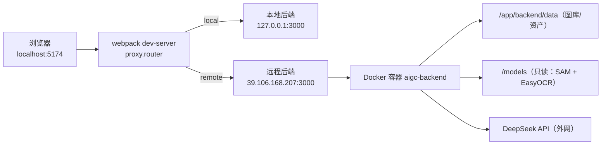

# 远程后端部署报告

> 生成时间：2026-10-29（Asia/Shanghai）
> 适用对象：接手本项目的 agent / 工程师
> 目标：后端在远程服务器常驻运行，本地只跑前端，通过 dev-server proxy 访问

---

## 1. 结论摘要

| 项 | 状态 |
| --- | --- |
| 远程后端 | ✅ 运行中，`http://39.106.168.207:3000` 公网可直连 |
| 健康检查 | ✅ `/health` 200，`ffmpeg/ffprobe/heifConvert` 均为 true |
| 业务接口 | ✅ 图库、上传、分析、合成、素材接口均验证通过 |
| 图像分析链路 | ✅ DeepSeek → SAM/EasyOCR → 语汇 → 回填 全流程跑通 |
| HEIC 支持 | ✅ heif-convert 1.23.6，真机 HEIC 端到端上传成功 |
| 本地后端 | ✅ 也已在本机 3000 启动，可在前端实时切换 |

---

## 2. 目标架构



前端**不直连**后端，所有请求都是相对路径，由 dev-server 代理转发；切换后端只改代理目标。

---

## 3. 服务器环境（实测）

| 项 | 值 |
| --- | --- |
| IP | `39.106.168.207` |
| 登录 | `root` + `~/.ssh/aliyun-aigc.pem`（RSA，chmod 600） |
| OS | Ubuntu 22.04.5 LTS |
| 规格 | 4 vCPU / 7 GB 内存（6 GB 可用）/ 69 GB 磁盘（31 GB 可用） |
| Docker | 29.9.2，build a82e528 |
| Docker Compose | v5.6.1 |
| 项目目录 | `/root/aigc` |
| 镜像加速 | `/etc/docker/daemon.json` 已配 daocloud / 1ms / dockerproxy |
| 公网端口 | 3000 已放行（阿里云轻量应用服务器防火墙） |

---

## 4. 部署产物

### 4.1 镜像

```
deploy-backend:latest   5.54 GB
```

Dockerfile：`deploy/Dockerfile.backend`（`FROM python:3.9-slim`）

| 层内容 | 关键版本 |
| --- | --- |
| Base | python 3.9.25（`/usr/local/bin/python3`） |
| 系统包 | ffmpeg 7.1.5、**libheif-examples 1.23.6**、git、build-essential、libgl1、libgomp1 |
| Node | 24.9.0 + pnpm 9.12.0 |
| Python 包 | torch 2.2.2+cpu、torchvision 0.17.2+cpu、**numpy 1.26.4**、**opencv-python-headless 4.10.0.84**、easyocr 1.7.2、segment-anything 1.0、scipy 1.13.1、scikit-image 0.24.0 |
| Node 依赖 | `pnpm install --frozen-lockfile --ignore-scripts`（608 包） |
| 构建产物 | `pnpm --filter @marketing-photo/backend build` → `/app/backend/dist` |

`--ignore-scripts` 导致 `ffmpeg-static` 不会下载二进制，因此**必须**用系统 ffmpeg（见环境变量）。

### 4.2 容器

| 项 | 值 |
| --- | --- |
| 名称 | `aigc-backend` |
| 镜像 | `deploy-backend:latest` |
| 状态 | `Up`，`restart: unless-stopped` |
| 端口 | `0.0.0.0:3000->3000/tcp`（含 IPv6） |
| 挂载 | `/root/aigc/models → /models (ro)`；`/root/aigc/backend/data → /app/backend/data (rw)` |
| 日志 | json-file，单文件 20MB，保留 3 个 |
| 工作目录 | `/app`（**注意**：不是 `/app/backend`） |

### 4.3 环境变量（容器内实测）

```text
NODE_ENV=production
BACKEND_HOST=0.0.0.0
BACKEND_PORT=3000
DATA_ROOT=/app/backend/data
FFMPEG_PATH=/usr/bin/ffmpeg
FFPROBE_PATH=/usr/bin/ffprobe
HEIF_CONVERT_PATH=/usr/bin/heif-convert
WORKFLOW_PYTHON=/usr/local/bin/python3
WORKFLOW_PYTHONPATH=/usr/local/lib/python3.9/site-packages
WORKFLOW_MODELS_DIR=/models
SAM_CHECKPOINT=/models/sam_vit_b.pth
EASYOCR_MODEL_DIR=/models/easyocr
EASYOCR_NETWORK_DIR=/tmp/easyocr-network
DEEPSEEK_API_KEY=<来自 deploy/.env，不入库>
```

### 4.4 模型与数据

| 路径 | 内容 | 体积 |
| --- | --- | --- |
| `/root/aigc/models/sam_vit_b.pth` | SAM ViT-B | 358 MB |
| `/root/aigc/models/easyocr/` | `craft_mlt_25k.pth`、`zh_sim_g2.pth` | 101 MB |
| `/root/aigc/backend/data/` | 图库 `inspiration` + 资产 `live-assets` | 435 MB |

> 远程 `backend/data` 比本地（166 MB）更完整，部署时**未覆盖**，避免丢失历史分析结果。

---

## 5. 复现步骤

```bash
# 0. 变量
SSH="ssh -i ~/.ssh/aliyun-aigc.pem -o StrictHostKeyChecking=no root@39.106.168.207"

# 1. 同步代码（排除大资源与运行时数据）
rsync -az -e "ssh -i ~/.ssh/aliyun-aigc.pem" \
  --exclude node_modules --exclude .git --exclude models \
  --exclude backend/data --exclude resources/crawl-raw \
  --exclude backend/dist --exclude frontend/dist --exclude .vscode \
  ./ root@39.106.168.207:/root/aigc/

# 2. 准备密钥（仅首次，服务器本地维护）
#    /root/aigc/deploy/.env 内写 DEEPSEEK_API_KEY=...

# 3. 构建并启动
$SSH 'cd /root/aigc && docker compose -f deploy/docker-compose.remote.yml up -d --build'

# 4. 校验
curl -s http://39.106.168.207:3000/health
```

`deploy/docker-compose.remote.yml` 为远程专用编排（只起 backend，不含 Caddy/web）。

---

## 6. 验证记录（实测）

| 检查 | 命令 | 结果 |
| --- | --- | --- |
| 健康 | `GET /health` | 200，`{"status":"ok","apiVersion":"photo-library-demo-v1","deepSeekConfigured":true,"tools":{"ffmpeg":true,"ffprobe":true,"sips":false,"heifConvert":true}}` |
| 图库配置 | `GET /api/v1/gallery/config` | 200 |
| 图库素材 | `GET /api/v1/gallery/motionsites` | 200，返回分类与 folders |
| 演示素材 | `GET /api/v1/demo-assets` | 200 |
| 照片库 | `GET /api/v1/photo-library` | 200 |
| 批任务 | `GET /api/v1/workflow/batches` | 200 |
| 重试状态 | `GET /api/v1/workflow/reanalyze/status` | 200 |
| 图片资源 | `GET /gallery/motionsites/uploads/beauty_02_*.webp` | 200，32,872 B |
| 分析链路 | 上传 `poster.jpg` → `/api/v1/workflow/analyze` | 主体探查 done（2332 tokens）→ 色块探查 done → 文字探查 done → 语汇分析 done → 代码回填 done |
| OCR 能力 | 容器内 easyocr 识别 `magazine/beauty_02.webp` | detected: 27 段 |
| HEIC 转码 | `FfmpegPreviewTranscoder.createPoster(heic)` | 3024×4032 → **2000×2666**，495 KB，方向正确 |
| HEIC 端到端 | `POST /api/v1/live-assets/apple-pair`（HEIC+MOV） | `status: ready`，`durationMs: 2167`；poster 634 KB、motion.mp4 805 KB 均可 200 下载 |

---

## 7. 部署过程中修复的问题

| # | 现象 | 根因 | 修复 |
| --- | --- | --- | --- |
| 1 | 上传后 Node 进程直接退出，容器重启、任务丢失 | `spawn /usr/bin/python3` ENOENT：镜像内 python 在 `/usr/local/bin/python3`；且子进程 `error` 事件未处理 | Dockerfile 设 `WORKFLOW_PYTHON=/usr/local/bin/python3`；`workflow.routes.ts` 增加 `child.on("error")` |
| 2 | 文字探查报 `Numpy is not available` | torch 2.2.2 用 NumPy 1.x 编译，pip 装了 numpy 2.0.2 / opencv 5.x | 固定 `numpy==1.26.4`、`opencv-python-headless==4.10.0.84` |
| 3 | 图库/上传数据写到了容器内 `/app/data` | 启动目录为 `/app`，`DATA_ROOT` 默认 `cwd/data`，与挂载点不符 | 显式 `DATA_ROOT=/app/backend/data` |
| 4 | Python 拿不到 DeepSeek 密钥 | 脚本只读 `.env.local`，容器内无该文件 | `workflow-analyze.py` 增加 `os.environ["DEEPSEEK_API_KEY"]` 兜底 |
| 5 | HEIC 只能解出 512×512 图块 / 半分辨率 | 容器 ffmpeg 无 HEIF 解复用器 | 安装 `libheif-examples`；非 macOS 环境优先走 `heif-convert` 再缩放烘焙方向 |
| 6 | `ffmpeg-static` 无二进制 | `--ignore-scripts` | 装系统 ffmpeg 并设 `FFMPEG_PATH`/`FFPROBE_PATH` |

---

## 8. 已知限制与风险

| 风险 | 说明 | 建议 |
| --- | --- | --- |
| **3000 端口对公网开放** | 任何人可访问并消耗 DeepSeek 额度 | 安全组限制来源 IP，或改用 Caddy 反代 + 认证，只暴露 80/443 |
| `sips` 不可用 | macOS 专有，Linux 上恒为 false | 已由 heif-convert + ffmpeg 覆盖；无需处理 |
| `thumb.jpg` 可能 404 | 缩略图由 `LocalPhotoLibrary.ensurePreview` 懒生成，上传流程不产出；历史 42 个资产仅 12 个有 thumb | 前端需回退到 poster；或把 `createThumbnail` 改为 ffmpeg 实现 |
| 单容器无 healthcheck | compose 未配置 `healthcheck` | 可加 `wget -qO- 127.0.0.1:3000/health` 探活 |
| 镜像 5.54 GB | torch + 系统包占大头 | 可用多阶段构建瘦身 |
| CPU 推理较慢 | 4 vCPU，EasyOCR 多尺度 + SAM 为 CPU 推理 | 单张分析约 1–3 分钟；可考虑队列限流 |
| 数据在宿主机目录 | `/root/aigc/backend/data` 直接挂载 | 定期备份该目录 |

---

## 9. 回滚

```bash
# 回滚代码
ssh ... 'cd /root/aigc && git checkout <上一个提交>'   # 或重新 rsync 旧代码
# 回滚到指定镜像
ssh ... 'docker tag deploy-backend:<旧镜像ID> deploy-backend:latest && docker compose -f deploy/docker-compose.remote.yml up -d'
# 完全停止
ssh ... 'cd /root/aigc && docker compose -f deploy/docker-compose.remote.yml down'
```

数据安全：`backend/data` 与 `models` 均为宿主机目录，`down` 不会删除。

---

## 10. 相关文件

| 文件 | 作用 |
| --- | --- |
| `deploy/docker-compose.remote.yml` | 远程后端编排（本次新增） |
| `deploy/Dockerfile.backend` | 后端 + Python 分析栈镜像 |
| `deploy/README.md` | 部署步骤与踩坑清单 |
| `backend/src/runtime/build-server.ts` | 工作流脚本路径/Python 解释器解析 |
| `resources/deepseek/crawl/workflow-analyze.py` | 分析脚本（模型路径、密钥均可环境变量覆盖） |
| `docs/FRONTEND-API-REPORT.md` | 前端接口情况报告（配套文档） |
