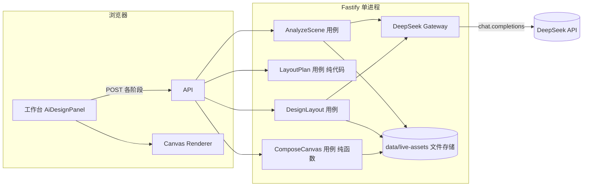
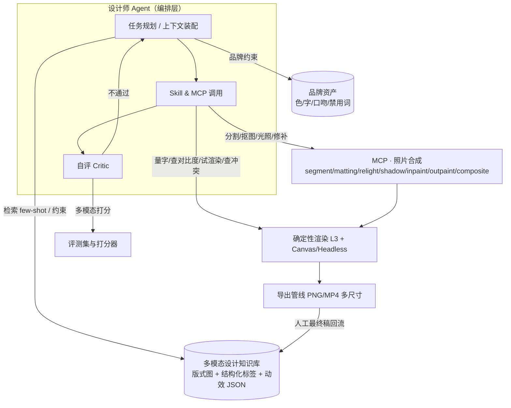

# 技术方案 · 从「提示词流水线」到「设计师 Agent + 合成 MCP」

- 版本：v0.2（2026-10-26）
- 对应代码：`source/backend`、`source/frontend`、`source/native`
- 关联：`00-产品PRD.md`、`02-局限与增强路线.md`、`04-数据契约.md`、`prompts/*.prompt.md`

---

## 1. 技术栈与仓库结构

- Monorepo：pnpm workspace；Node 24 / TypeScript 5.9 / ESM。
- 后端：Fastify 5 + zod 4 + `openai` SDK（兼容 DeepSeek endpoint）+ ffmpeg-static（实况转码）+ vitest。
- 前端：Vue 3.5 `<script setup>` + ant-design-vue 4 + webpack 5 + vue-tsc + vitest。
- 原生：`native/macos-photo-helper`（Swift，解析 HEIC+MOV 配对、提取实况帧）。

```
backend/src/
├─ runtime/            build-server.ts（依赖装配）、main.ts
├─ shared/             errors / config / utils
└─ modules/
   ├─ design-assistant/
   │  ├─ domain/       ← 业务规则与纯函数（提示词目录、schema、validator、L1/L3 解算）
   │  ├─ application/  ← 用例（analyze-scene / layout-plan / design-layout / compose-canvas）
   │  ├─ infrastructure/← DeepSeek gateway、本地文件存储
   │  └─ interfaces/http/← 路由
   └─ live-asset/      实况照片上传、转码、元数据
frontend/src/
├─ pages/live-workbench/    工作台页
├─ features/design-assistant/  L1/L2 面板（AiDesignPanel.vue）
├─ features/canvas-renderer/   Canvas 渲染器 + 主体描边 overlay
└─ features/motion-effects/    动效时间轴（static / timeline 双模式）
```

## 2. 现有架构



### 2.1 三层职责与「不许越界」

| 层 | 输入 | 输出 | 谁负责「准确」 |
|---|---|---|---|
| L1 构图 | `SceneAnalysis`（主体/安全区/主色） | `LayoutPlan`（承载区、候选配色） | 纯代码：像素覆盖率 + 决策网格 |
| L2 设计 | 事实资料 + 画面理解 + L1 结论 + 动效目录 + 文案正反例 | `DesignSpec`（**无坐标、无毫秒**） | LLM + validator 夹取 |
| L3 解算 | `DesignSpec` + `LayoutPlan` + `SceneAnalysis` | `CompositionSpec`（坐标/时间轴/图层） | 纯函数：边距、堆叠、重叠消解、特效避让 |

设计动机：模型擅长「意图」，不擅长「数值」。把数值交给代码后，结果是可复现的、可被单元测试覆盖的、可被夹取修正的。

### 2.2 HTTP 接口（现状）

| 方法 | 路径 | 说明 |
|---|---|---|
| POST | `/api/v1/live-assets/:id/scene-analysis?refresh=1` | 画面理解（可命中缓存；提示词版本号变了会失效） |
| POST | `/api/v1/live-assets/:id/layout-plan` | L1 构图（纯代码） |
| POST | `/api/v1/live-assets/:id/design-layout` | L2 设计（LLM，含 1 次带 issues 重试） |
| POST | `/api/v1/live-assets/:id/compose` | L3 解算（纯函数，≈12ms） |
| GET | `/api/v1/live-assets/:id/design` | 读已保存的 DesignSpec |
| GET | `/api/v1/live-assets/:id/copy-source` | 读 `selfies/<key>.md` 事实资料 |
| POST | `/api/v1/live-assets/:id/composition` | 旧版一次性出图（legacy，保留下限） |

### 2.3 提示词工程现状

- 版本常量：`DESIGN_PROMPT_VERSION = 4`、`SCENE_ANALYSIS_PROMPT_VERSION = 7`（改提示词必须 +1，否则缓存沿用）。
- 三段式注入：
  1. **事实**：运营写的「照片事实背景 + 想突出什么」。
  2. **正反例**：`copy-rules.catalog.ts`（18 反例 / 18 正例 / 10 组改写对照）。
  3. **能力目录**：`motion-catalog.ts`（动效 id + 参数范围 + 枚举，唯一事实源）。
- 回路：`DesignSpec` 先过 zod（结构）→ 再过 `validateDesignSpec()`（业务：锚点/颜色/字数/3D 仅限 headline/参数夹取/设计说明拦截）→ 有 issues 就带 issues 再要一次 → 取 issues 更少的那次。
- 全文见 `prompts/01-scene-analysis.prompt.md`、`prompts/02-design-layout.prompt.md`。

### 2.4 渲染

- `createEffectTimeline(layers, durationMs)` 提供两种取样：
  - `snapshot()`：**静态封面 = 最终形态**（`staticFrame: true`，描边画满、文字全显、滤镜铺开）。
  - `sample(t)`：播放态（入场进度、动效相位、闪烁/划线进度）。
- 渲染器按 `kind` 分派：`text`（9 种入场 + 变形 + 3D 质感 + 与主体重叠混色）与 `pulse`（sweep / drift / dot / outline / marker / laser / glow / soft / strobe）。

## 3. 现状技术局限（根因级）

> 产品视角的清单见 `02-局限与增强路线.md`；这里是**为什么**会发生。

### 3.1 排版精度：估算 vs 度量

`compose-canvas.ts` 的 `estimateBox()` 用「最长行字符数 × sizeRatio × 水平单位」估宽度。根因：

- 没有真实字体度量（`measureText`）在服务端可用；
- 中英混排、标点、字距（tracking）、旋转/缩放都会让估算偏移；
- 目前用「10% 边距 + 6 轮重叠推挤」兜底，属于**事后纠错**，不是**事前精确**。

**影响**：长句、混排、旋转标题偶发溢出或与相邻块挤在一起。

### 3.2 主体几何：20 点粗轮廓

画面理解只要 20 个点（实测 100 点会让分析从 23s 涨到 75s、token 涨 4.5 倍）。根因是「让视觉模型描边」这条路本身分辨率有限。

**影响**：描边效果沿多边形走线，人物发丝/手臂缝隙处会抖；「文字与主体重叠」的混色边界也只能按粗多边形算。

**正解**：把几何交给分割模型（SAM 系列 / 商用抠图 API），模型只负责「这是谁、值多少分」。

### 3.3 只能叠加，不能合成

现有渲染是 Canvas 2D 叠加层。没有：分割、蒙版、光照估计、投射阴影、修补（inpaint）、重定位。

**影响**：构图完全迁就原照片；无法把主体挪到更好的留白，也无法做「光影统一」的高级效果（例如树影真的落在主体上）。

### 3.4 单次生成，无比较

`temperature = 0` 单发。没有 best-of-n、没有自评分、没有人改样本回流。

**影响**：模型偶发的「审美塌陷」（文案串味、版式拥挤）无处拦截；改进只能靠改提示词碰运气。

### 3.5 无检索、无记忆、无品牌

所有约束都在提示词字符串里。没有：设计案例库、品牌资产、历史修改记录、账号级风格画像。

**影响**：无法「像这个品牌」；不同图片风格漂移；新需求只能继续往提示词里加规则（提示词膨胀 → 遵循度下降）。

### 3.6 工程形态

- 全同步单进程：分析 20s、设计 18s 都在请求里等；无队列、无并发隔离、无断点续跑。
- 无观测：没有 token 成本、失败率、重试率、人工改动率。
- 无导出管线：只有浏览器内 Canvas，没有 PNG/MP4、没有多尺寸。
- 无评测集：改一版提示词只能人眼看。

## 4. 目标架构



### 4.1 多模态设计知识库（P7 的正解）

**目标**：把「好版式」变成可检索、可复用、可解释的资产，并让 L2 从「凭语义猜」变成「照着案例改」。

数据结构（建议表 / 集合）：

```jsonc
{
  "id": "case_000123",
  "image": { "url": "...", "width": 1500, "height": 2000, "thumb": "..." },
  "spec": { /* 与 DesignSpec 同构：可直接作为 few-shot 输出示例 */ },
  "tags": {
    "scene": ["城市街拍", "室内静物", "户外风景"],
    "mood": ["暗调质感", "明亮清新", "复古潮流", "温情治愈"],
    "subjectFit": ["单人物", "商品特写", "群像", "建筑"],
    "platform": ["小红书 3:4", "故事 9:16", "封面 4:3"],
    "effects": ["subject-outline", "glow-mask"],
    "copyStyle": ["地点+季节", "单品卖点", "情绪短句"]
  },
  "quality": { "human": 4.6, "auto": 0.83, "acceptRate": 0.91 },
  "embedding": { "image": [/* CLIP/DINOv2 或商用多模态向量 */], "text": [/* 文案向量 */] },
  "source": "internal|licensed|synthetic",
  "rights": { "usableForFewShot": true, "license": "..." }
}
```

检索策略（三级）：

1. **结构化过滤**：平台比例 + 主体类型 + 调性（保证「同场景」）。
2. **视觉近邻**：用当前照片的缩略图向量召回视觉构成相似的案例。
3. **文本近邻**：用「事实资料摘要」召回文案风格相似的案例。

注入方式：3–5 个案例的 `spec` 作为**结构化 few-shot**（不是整张提示词示例），并把它们的「设计师理由」拼成一小段可读参考。这样比自由文本 few-shot 更省 token、更可控。

回流：人工最终稿（用户点「确认」时）写成新 case，`quality.human` 由人工评分给出；定期离线重算 auto score。

**工程落点**：

- 新增 `backend/src/modules/design-kb/`（domain: 检索接口；infrastructure: 向量库适配器（先用本地 SQLite + sqlite-vec / pgvector 均可））。
- `DesignLayout` 用例增加一个 port：`DesignKnowledgeBase.search(query) → cases[]`。
- 提示词新增一段 `【参考案例 N 组】`，放在动效目录之前。

### 4.2 设计师 Skill（P9 的正解）

把「设计师会用工具」这件事显式化。建议先做**确定性工具**（不花 token、可单测），再考虑让模型多轮调用。

| skill | 签名 | 作用 | 实现难度 |
|---|---|---|---|
| `measure_text` | `(text, font, size, tracking) → {width, height, lines}` | 真实字体度量，替换估算 | 低（node-canvas / opentype.js + 字体文件） |
| `check_contrast` | `(color, backdropRgb) → ratio` | 文字可读性（WCAG） | 低（已有对比度算法） |
| `detect_layout_conflict` | `(boxes[]) → conflicts[]` | 重叠/越界/贴边 | 低（已有推挤算法可复用） |
| `render_preview` | `(spec) → png` | 服务端试渲染，让 critic 看图 | 中（headless canvas / skia-canvas） |
| `query_design_kb` | `(query) → cases` | 知识库检索 | 中 |
| `score_layout` | `(spec, analysis) → {score, reasons}` | 规则打分（对比度/密度/边距/主体遮挡） | 中 |

**两种用法**（建议 P1 先做第一种，成本最低）：

1. **编译期调用**（推荐起步）：L2 输出后，编排层依次调用 `measure_text` 修正文字盒 → `detect_layout_conflict` 消解 → `check_contrast` 校正颜色 → `score_layout` 打分；分数低就带着「分数理由」重生成。模型不需要知道这些工具存在。
2. **运行时 tool-calling**：把工具暴露给模型多轮调用（`function calling`）。收益是模型能主动试错，成本是多轮 token 与时延，需要严格预算。

### 4.3 照片合成 MCP（P1 / P3 / P5 的正解）

统一封装成一个 MCP server（`compose-mcp`），工具列表：

| 工具 | 输入 | 输出 | 用途 |
|---|---|---|---|
| `segment` | image, hints(points/box) | mask[] | 主体/背景/天空分割（SAM 类） |
| `matting` | image, mask | 带 alpha 的 PNG | 精细抠图（发丝级），替代 20 点多边形 |
| `inpaint` | image, mask, prompt | image | 去掉杂物、补背景、扩画布（outpaint 可用同接口 + 扩展 mask） |
| `relight` | image, subjectMask, lightDir/色温 | image | 让主体与新背景/氛围光一致 |
| `shadow` | subjectMask, lightDir | shadowLayer | 投射阴影，解决「贴纸感」 |
| `composite` | layers[], blend modes, colorMatch | image | 真正的图层合成 + 色彩匹配 |
| `relocate` | image, subjectMask, targetBox, sceneRef | image | 把主体搬到更好的留白（**这是突破「只能迁就原图」的关键**） |
| `upscale` | image, ×2/×4 | image | 导出前放大 |

**与流水线的接口约定**：MCP 只做「像素」，不产出设计决策。L2/L3 仍决定「放哪儿、写什么」。

扩展后的请求流（建议）：

```
DesignSpec 生成 → 编排层调用 compose-mcp 做图像基座（分割/重定位/光影）
              → L3 在该基座上解算文字层 → render_preview → critic 打分
              → composite 合成（文字层 + 光效层 + 图像基座）→ export
```

### 4.4 自评 Critic（P8 的正解）

四个维度，先规则、后模型：

1. **可读性**：文字与底色的对比度、字号下限、遮挡比例（规则）。
2. **版面**：重叠、越界、密度、单一视觉重心（规则 + 已有推挤算法）。
3. **语义**：文案是否只用了资料里的事实（关键词/实体对齐）、是否混入设计术语（已有 40+ 词表）。
4. **美学**：多模态模型给 1–5 分 + 一句理由（成本可控时用）。

组合策略：3 候选 → 规则分筛选 → 取前 2 送美学打分 → 取最优。草稿模式只出 1 候选省成本。

### 4.5 导出与工程化（P6 / P13 / P14）

- **渲染服务化**：把前端 Canvas 渲染逻辑抽成同构模块（浏览器 + node-canvas/skia-canvas 双跑），保证「预览 = 导出」。
- **视频导出**：按 30fps 逐帧采样 `sample(t)` → 图像序列 → ffmpeg-static 合成 MP4（已依赖 ffmpeg，可直接复用）。
- **多尺寸**：`CompositionSpec` 增加 `targets[]`，L3 按目标比例重解算（边距/字号跟随短边，锚点按新网格重投影）。
- **队列与幂等**：`assetId + promptVersion + designHash` 作为幂等键；长任务进队列（BullMQ / pg-boss），前端轮询或 SSE。
- **观测**：每个阶段打点（耗时、token、issues 数量、人工改动标记），落到一张 `generation_runs` 表。

## 5. 增量改造点（代码级）

| 需求 | 落点 | 兼容策略 |
|---|---|---|
| 真实字体度量 | 新增 `domain/typography.ts`（`measureText`），`estimateBox` 内部改为调用 | 度量不可用时自动回退估算（同一接口） |
| 候选与打分 | `application/design-layout.ts` 改为 `generate(n)` + `pickBest()` | 新增 `candidates` 字段到响应，`design` 仍保留单值 |
| 知识库 | 新模块 `design-kb`；`DesignLayout` 注入 port | 未配置 KB 时 `search()` 返回 `[]`，提示词少一段 |
| 品牌资产 | 新模块 `brand-kit`；`DesignContext` 增加 `brand` | 同上，缺省不影响现有行为 |
| 合成 MCP | 新模块 `compose-mcp`（client + 工具层） | 只有配置了 MCP endpoint 才走合成分支 |
| 导出 | 新模块 `export`（renderer + ffmpeg） | 独立接口 `/export`，不改现有 4 个接口 |
| 队列 | `runtime/build-server.ts` 增加 queue 装配 | 默认内存队列，单机无 Redis 也能跑 |

**契约扩展原则**：只加字段、不改语义；`version` 字段（DesignSpec / CompositionSpec / SceneAnalysis）负责灰度；旧 `design.json` 必须仍能被新版 L3 解算。

## 6. 里程碑与 DoD

| 里程碑 | 内容 | DoD |
|---|---|---|
| M1（2–3 周） | 真实度量、3 候选、评测集 50 例、PNG 导出、观测打点 | 评测集回归通过；人工改动率基线建立 |
| M2（4–6 周） | 知识库 v1、品牌资产、5 个 skill、critic v1 | 人工改动率 ≤ 60% 基线；风格一致性人评 ≥ 4 |
| M3（6–8 周） | 合成 MCP（segment/matting/relight/composite）、MP4 导出、多尺寸、队列 | 支持「主体重定位 + 光影匹配」；3 尺寸 30s 内出图 |
| M4 | Agent 编排、记忆与回流、合规审核 | 端到端无人值守出稿 + 人工一键确认 |

## 7. 开放问题

1. **像素级合成是否必需？** 若目标是「营销博客」而非「广告大图」，也许「高质量叠加 + 精准排版」已够；合成 MCP 应先用 A/B 验证收益再全量投入。
2. **知识库版权**：案例图能否作为 few-shot？建议只存「结构化 spec + 缩略图指纹」，图本身不落库。
3. **字体版权**：品牌字体需授权台账；开源字体（思源系列）作为默认。
4. **评测的主观性**：美学分与人评的一致性需要校准（先做 50 例 blind test）。
5. **时延与成本曲线**：best-of-n + critic 会让单图成本翻 2–3 倍，需按「草稿/终稿」分级授权。
